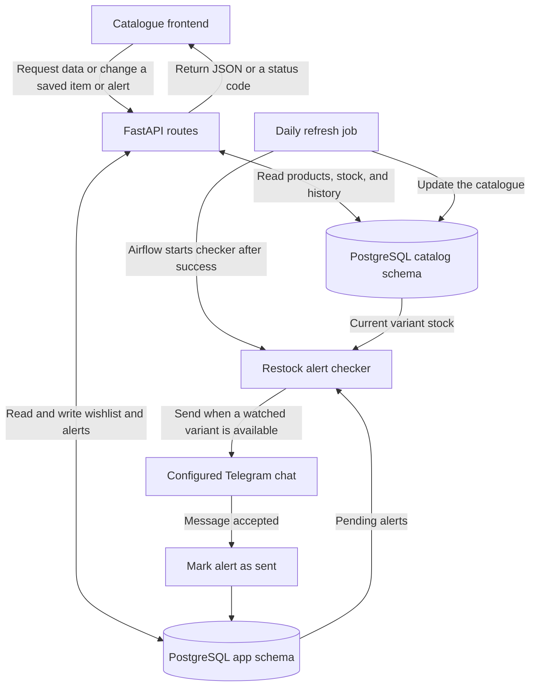

## What is the project?

The Catalogue backend serves product data to the website and manages its wishlist and restock alerts. It connects the catalogue collected from Shopify stores to the features shoppers use.

## What does it do?

- Lists brands and products with search, filters, sorting, and pagination.
- Returns product details with variant prices, stock status, and change history, plus a feed of recent updates.
- Saves and removes wishlist items and lets shoppers create or cancel alerts for sold-out variants.
- Sends Telegram notifications when watched variants return to stock.

## How does it work?

The API runs on Python with FastAPI and Uvicorn. It uses a psycopg connection pool to read products, variants, and change history from the PostgreSQL `catalog` schema. It reads and writes wishlist items and alerts in the `app` schema.

Airflow runs a separate Python alert checker after a successful catalogue refresh. The checker matches pending alerts against current stock, sends a message to the configured Telegram chat, and marks each alert as sent after Telegram accepts it. Failed sends stay pending for a later run.

## Working Flowchart

